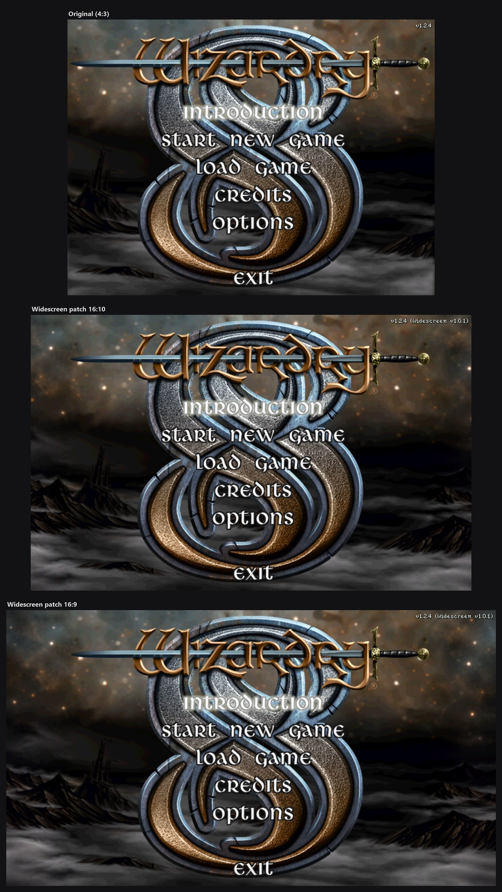
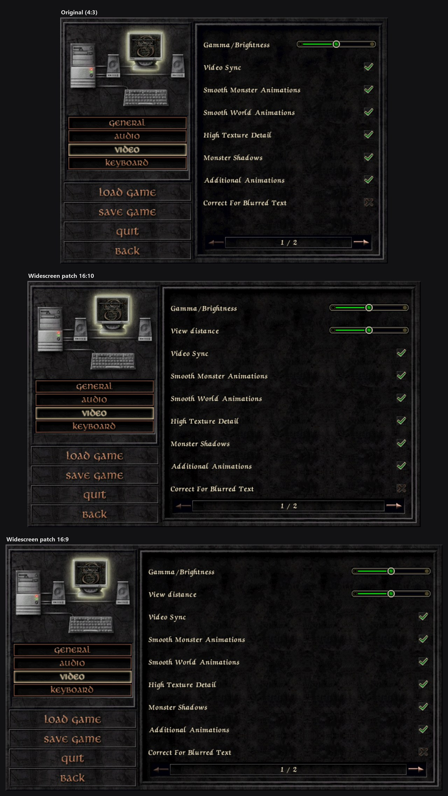
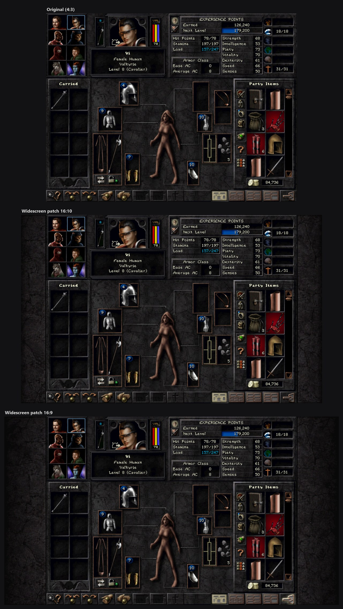
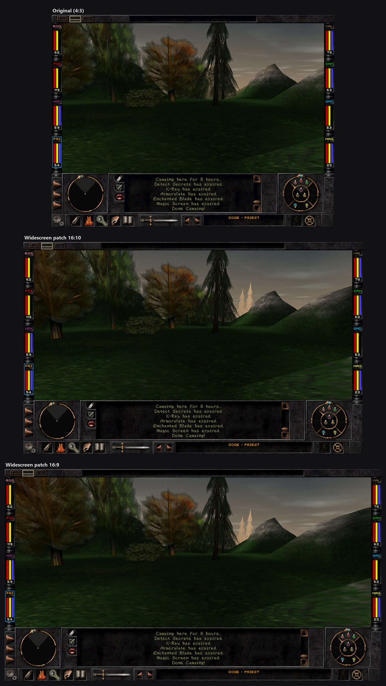
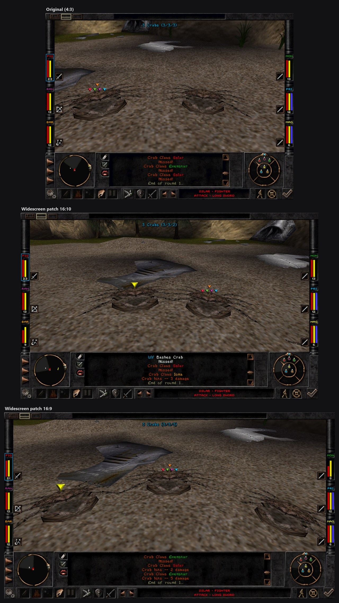

# Wizardry 8 Widescreen

Native widescreen patch for **Wizardry 8** (GOG / Steam version 1.2.4, both ship the same
`Wiz8.exe`). The 2D interface and the 3D view are drawn wide (16:9, 16:10, 3:2 and the
original 4:3), with new wide loading screens, borderless / window / fullscreen modes and
display settings inside the game. Current release: **1.0.1** (2026-10-18), see
[docs/releases/1.0.1.md](docs/releases/1.0.1.md).

The original `Wiz8.exe` is never modified.

## Made with AI

This patch was built with AI. The reverse engineering, code, installer and documentation
were written by AI coding agents (Claude Code, using REA for reverse engineering), directed
and tested by abr17. The missing widescreen art was outpainted with generative AI: original
images are kept pixel-for-pixel, only the new side areas are generated, blended over a
narrow strip at the original edge.

## Screenshots

Each picture shows the same moment three times: the original game (4:3), then the patch at
16:10 and at 16:9.

**Main menu**: the menu art is extended to the full width; the corner shows the patch version.


**Options**: full-width option pages, with the patch's new settings (view distance; display mode and resolution on page 2).


**Character sheet**: kept at 4:3 in the centre, with stone side panels.


**Exploring**: the 3D view grows sideways (Hor+), and the party HUD moves to the screen edges.


**Combat**: the crab fight on the starting beach, at the end of round 1.


## How it works (one minute)

```
Wiz8.exe (original)  ──loads──>  version.dll   (our proxy: src/, built with llvm-mingw)
                                     │  checks the exe (SHA-256 + code signature);
                                     │  unknown exe -> does nothing, game runs as original
                                     └─loads──>  wiz8hy.dll  (the "hybrid": game functions
                                                 rebuilt from decompiled source with our
                                                 widescreen changes; each one replaces the
                                                 original function via a jmp patch; 287 in 1.0.x)
```

* The game's source code comes from a public **decompilation** of Wizardry 8
  ([agluszak/wizardry-8-decomp](https://github.com/agluszak/wizardry-8-decomp)). Our changes to
  it are published as a fork, [abr17/wizardry-8-decomp](https://github.com/abr17/wizardry-8-decomp)
  (branch `widescreen`, tags `wiz8-widescreen-<version>`), included here as the `decomp/` submodule;
  `wiz8hy.dll` is built from it (see [docs/decomp-fork.md](docs/decomp-fork.md)). That code is
  **not** under this repository's MIT licence: upstream has no licence file, and part of it is
  under Strategy First's non-commercial source licence (see the fork's README). The release
  zip ships the prebuilt `wiz8hy.dll`. The game code can also be built as a whole new exe,
  `Wiz8Runtime.exe` (the "port"), an **internal** tool for testing; it is never shipped.
* `wiz8hy.dll` contains only the functions we changed; everything else stays the original,
  tested game code. See [docs/hybrid.md](docs/hybrid.md).
* Wide art (loading screens, stretched panels, side wings) are `.STI` files in the game's
  own format, made from the game's art. They live in `assets/` (not in git).

## Repository map

| Path | What | In git |
|---|---|---|
| `src/` | `version.dll`: proxy loader, exe check, ini, legacy hooks, hybrid loader (`hooks_hybrid.cpp`) | yes |
| `src/hybrid/` | `HybridInstall` (patches the original functions); compiled **into `wiz8hy.dll`** | yes |
| `src/w8diff_dll/` | `w8diff.dll` of the internal comparison harness | yes |
| `CMakeLists.txt`, `cmake/`, `build.ps1` | build of `version.dll` (llvm-mingw, i686) | yes |
| `third_party/minhook` | hooking library (git submodule) | yes |
| `tools_src/setup/` | `Wiz8WideSetup.exe`, the installer (Win32 C++, en/ru/de/fr) | yes |
| `dist/` | files shipped as-is: `wiz8ws.ini`, `wiz8wide.ini`, `README_*.txt` for players | yes |
| `scripts/` | build, package, hybrid, test-play, art and analysis scripts, see [scripts/README.md](scripts/README.md) | yes |
| `docs/` | documentation, see [docs/README.md](docs/README.md) | yes |
| `decomp/` | game source: the decompilation + our changes; git submodule [abr17/wizardry-8-decomp](https://github.com/abr17/wizardry-8-decomp) at tag `wiz8-widescreen-1.0.1` (not MIT, see above) | yes (submodule) |
| `assets/` | wide `.STI` art, `FALCON.STI`, dgVoodoo 2 files, laid out like the game folder | no |
| `games/` | game copies: `reference` (pristine, read-only), `work` (test copy with the patch), `ru` (test copy with the Russian translation) | no |
| `Tools/` | portable toolchain (llvm-mingw, CMake, portable MSVC, Ghidra, ...) | no |
| `build/` | build output (`version.dll`, `hybrid/`, `vc2022/` port build, `package/`) | no |
| `release/` | released zips exactly as published (`Wiz8Widescreen-<version>.zip`) | no |
| `ghidra/`, `ref/` | Ghidra project and binaries for analysis; clone of the upstream decompilation (reference) | no |

The folders outside git contain game code, game-derived art or large downloads, so they
stay local. [docs/building.md](docs/building.md) says where each one comes from.

## Quick start

The workspace must be at **`C:\dev\wiz8-ws`** (several scripts and `.mcp.json` use that path),
cloned with submodules (`git submodule update --init`, which also fetches `decomp\`). It needs
`Tools\` and `assets\` (not in git, see [docs/building.md](docs/building.md)); `assets\` comes from a
release zip in one command: `pwsh -File scripts\build\import-release.ps1 -Zip <Wiz8Widescreen-x.y.z.zip>`.

```powershell
. .\Tools\env.ps1                                       # portable tools for this shell only
.\build.ps1                                             # build\version.dll
powershell -File scripts\build\build-decomp.ps1         # once: port build, makes the .lib files the hybrid links against
powershell -File scripts\hybrid\build_hybrid.ps1        # build\hybrid\wiz8hy.dll + wiz8hy_hooks.txt
pwsh -File scripts\build\make-hybrid-package.ps1        # build\package\Wiz8Widescreen-<VERSION>.zip
```

To try a change in the game, install into the test copy (`.\build.ps1 -Install`,
`scripts\hybrid\build_hybrid.ps1 -Install`) and run `games\work\Wiz8.exe`.
[docs/building.md](docs/building.md): toolchain, every build, changing game code, release
checklist. [docs/testing.md](docs/testing.md): test copies, automated play, pitfalls.

## Rules of this workspace

* Everything lives inside this folder: tools are portable, nothing goes to the system
  PATH, the registry or outside the folder (Python 3 and PowerShell 7 are the only
  system-wide programs used).
* `games/reference` and the real GOG/Steam installs are read-only.
* `wiz8hy.dll` and `wiz8hy_hooks.txt` always travel together (a stale hooks file crashes the
  game at start-up).
* We fix original-game bugs only when they get in the way of widescreen.
* Only the official GOG/Steam 1.2.4 exe is supported; unofficial builds (e.g. the Russian
  translation's own exe) are not. The Russian translation's `Data` works with the patch.

Rules for AI agents working here: [CLAUDE.md](CLAUDE.md).

## License

The code and documentation in this repository are under the [MIT License](LICENSE). This does
not cover Wizardry 8 itself, its files or art, the decompiled game code in the `decomp/`
submodule (upstream's terms and Strategy First's non-commercial source licence apply there), or
third-party components (MinHook has its own licence in `third_party/minhook`; dgVoodoo 2,
included in the release package, is distributed under its author's terms).
